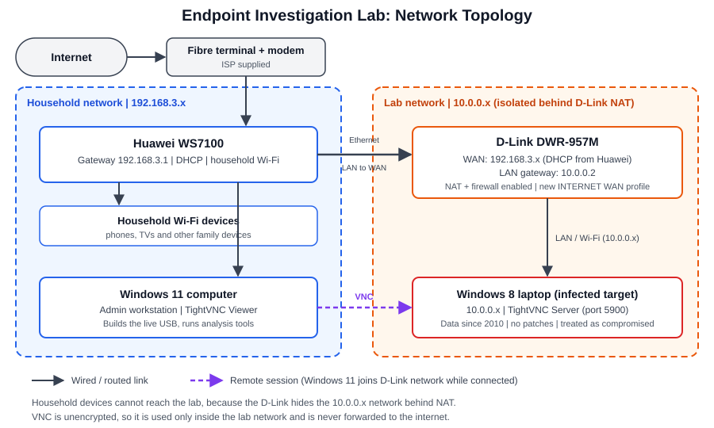

# 🛡️ Endpoint Investigation Lab

## Project Status

🚧 **In Progress: Phase 1 complete, Phase 2 (Data Preservation) under way**

The lab network is built and working. The legacy Windows 8 laptop sits in an isolated network segment and can be administered remotely from a Windows 11 workstation. The next step is to back up the laptop's data safely, then investigate the infection.

The project started as an idea for investigating a suspected malware infection on a legacy Windows laptop. It has grown into a broader **home networking, Windows administration, and cybersecurity laboratory**.

---

## 📌 Overview

The original idea came from a real issue: an older Windows laptop showing abnormal behaviour, including unusual USB file handling (files hidden inside a folder on a memory stick when it is plugged in) and instability during large file transfers. The laptop holds personal data from 2010 onward, so the goal is to investigate it and preserve that data rather than immediately formatting the machine.

---

## 🎯 Project Objectives

- Design and document a home network environment.
- Investigate the behaviour of a legacy Windows endpoint.
- Practice Windows administration and troubleshooting.
- Implement secure remote administration.
- Apply networking concepts in a practical environment.
- Safely preserve and back up important data.
- Investigate potential malware or persistence mechanisms.
- Collect and analyse Windows security and system logs.
- Practice PowerShell administration and automation.
- Document findings and remediation procedures.
- Apply security and access-control principles learned through Azure (AZ-104) training.

---

## 🗺️ Network Topology

The D-Link router is connected behind the Huawei router, which creates a double NAT. Lab devices can reach the internet, but household devices cannot reach the lab.

### Addressing

| Device                                  | Address     | Notes                              |
| --------------------------------------- | ----------- | ---------------------------------- |
| Huawei WS7100 (household gateway)       | 192.168.3.1 | Household subnet 192.168.3.x       |
| D-Link DWR-957M, WAN side               | 192.168.3.x | Assigned by the Huawei via DHCP    |
| D-Link DWR-957M, LAN side (lab gateway) | 10.0.0.2    | Lab subnet 10.0.0.x                |
| Windows 8 laptop                        | 10.0.0.x    | Reserve this address in the D-Link |

The two subnets do not overlap, so no change to the D-Link's LAN address was needed.

---

## 🧰 Hardware Register

| Item                             | Role                                   | Status  |
| -------------------------------- | -------------------------------------- | ------- |
| Fibre wall terminal and modem    | ISP connection                         | In use  |
| Huawei WS7100                    | Household router and Wi-Fi             | In use  |
| D-Link DWR-957M                  | Lab router                             | In use  |
| Windows 11 computer              | Admin workstation, builds the live USB | In use  |
| Windows 8 Single Language laptop | Infected lab target, data since 2010   | In use  |
| 32 GB USB flash drive            | Linux Mint live USB                    | In use  |
| External hard drive              | Backup destination (lab-only)          | Planned |
| Ethernet cables                  | Router link and lab connections        | In use  |

Laptop specifications will be added once recorded.

## 💾 Software Register

| Software                  | Version        | Installed on                               | Purpose                                                                         | Source                       |
| ------------------------- | -------------- | ------------------------------------------ | ------------------------------------------------------------------------------- | ---------------------------- |
| TightVNC Server           | To be recorded | Windows 8 laptop                           | Remote screen access                                                            | Official TightVNC website    |
| TightVNC Viewer           | To be recorded | Windows 11 computer                        | Remote control client                                                           | Official TightVNC website    |
| Linux Mint (MATE, 64-bit) | 22.3           | Downloaded on Windows 11, for the live USB | Live environment for backing up the laptop without running the infected Windows | NTT DATA South Africa mirror |
| Rufus                     | 4.15           | Windows 11 computer                        | Writes the ISO to the USB                                                       | Official Rufus website       |

### Download integrity

| File                          | SHA-256                                                              | Result                                                                                            |
| ----------------------------- | -------------------------------------------------------------------- | ------------------------------------------------------------------------------------------------- |
| linuxmint-22.3-mate-64bit.iso | `7609294da613b75eea89bb918292125e9f06418a368136fb190466e15bf8c373` | Matches the `sha256sum.txt` on the Harvard Linux Mint mirror. GPG signature check not yet done. |

Checksum command used on Windows 11: `certutil -hashfile <filename> SHA256`

### Planned software

- Sysinternals Autoruns and Process Explorer
- Wireshark
- VirtualBox or VMware with a Kali Linux VM
- Nmap and OpenVAS
- ClamAV or Malwarebytes (scanning backed-up data from a clean environment)

---

## 🔧 Configuration Summary

1. Connected a Huawei LAN port to the D-Link WAN port.
2. Left the D-Link's existing carrier profile (Service Type `TR069_INTERNET_VOIP`) unchanged.
3. Created a new WAN connection with Service Type `INTERNET`, IPv4, NAT on, firewall on, VLAN off, static DNS off, MAC override off.
4. Selected the new connection as the default route.
5. Verified connectivity with ping tests (below).
6. Installed TightVNC Server on the Windows 8 laptop and the Viewer on Windows 11, and confirmed a working remote session.

## ✅ Verification

| Test                                                                      | Result                                                  |
| ------------------------------------------------------------------------- | ------------------------------------------------------- |
| Laptop pings 10.0.0.2 (D-Link)                                            | Success                                                 |
| Laptop pings 8.8.8.8 (internet by IP)                                     | Success                                                 |
| Laptop pings google.com (DNS)                                             | Success                                                 |
| Phone on the D-Link Wi-Fi reaches the internet                            | Success                                                 |
| Laptop pings 192.168.3.1 (Huawei)                                         | Destination host unreachable, which indicates isolation |
| Windows 11 pings the laptop's 10.0.0.x address from the household network | Pending                                                 |
| Laptop opens 192.168.3.1 in a browser                                     | Pending                                                 |
| Remote session from Windows 11 to the laptop over VNC                     | Success                                                 |

---

## 🩹 Troubleshooting Log

| Problem                                                              | Cause                                                                            | Resolution                                                            |
| -------------------------------------------------------------------- | -------------------------------------------------------------------------------- | --------------------------------------------------------------------- |
| Unsure if the IPv4 configuration tab sets the internet connection    | That tab controls the router's own LAN side, not the upstream link               | Used the WAN settings instead                                         |
| Edit the existing WAN entry or create a new one                      | The existing entry was a carrier management profile                              | Left it alone and created a new `INTERNET` WAN service              |
| No field to enter an IP address                                      | The Huawei assigns the address via DHCP                                          | Nothing to enter; confirmed the WAN IP on the status page             |
| Dynamic Route offered RIP, OSPF and BGP                              | These are router-to-router protocols and are not needed here                     | Backed out and used Default Route                                     |
| Windows 8 laptop reached the admin page but not websites             | The admin page is local. The laptop's Chrome is outdated                         | Confirmed the network with ping tests and a phone on the D-Link Wi-Fi |
| Ping to 192.168.3.1 showed "host unreachable" but 4 packets received | Windows counts an error from a nearby device as a received packet                | Read as correct isolation                                             |
| Remote Desktop unavailable                                           | Windows 8 Single Language is a Home-level edition and cannot accept incoming RDP | Used TightVNC instead                                                 |

---

## 🔐 Security Measures

- The infected laptop stays off the household network and sits only behind the D-Link.
- NAT and the firewall are enabled on the lab WAN connection.
- USB drives used with the laptop are not plugged into the Windows 11 machine, because the infection spreads through USB sticks.
- The Windows 8 laptop receives no security patches, so it is treated as compromised and not used for real logins.
- VNC is unencrypted, so it is used only inside the lab network, never forwarded to the internet, and with a strong password.
- File transfer and clipboard sharing are disabled in the remote session, so nothing moves from the laptop to Windows 11.
- Download checksums are verified before use.

---

## 🗺️ Roadmap

### Phase 1: Lab & Network Preparation ✅

- [X] Document available hardware
- [X] Document the existing network
- [X] Create a network topology diagram
- [X] Configure the administrative workstation
- [X] Establish controlled connectivity between devices
- [X] Document IP addressing and network configuration

### Phase 2: Data Preservation 🔄

- [X] Download and verify the Linux Mint 22.3 MATE ISO
- [ ] Create the bootable live USB
- [ ] Identify important data
- [ ] Create backups (read-only copy of the original, then a working copy)
- [ ] Verify backup integrity
- [ ] Document the backup process

### Phase 3: Windows Administration

- [ ] Configure administrative access
- [ ] Practice PowerShell administration
- [ ] Review Windows services
- [ ] Review scheduled tasks
- [ ] Review startup applications
- [ ] Configure appropriate security controls

### Phase 4: Endpoint Investigation

- [ ] Review Windows Event Logs
- [ ] Investigate suspicious processes
- [ ] Examine network connections
- [ ] Investigate USB-related behaviour
- [ ] Identify possible persistence mechanisms
- [ ] Document findings

### Phase 5: Remediation

- [ ] Develop a remediation strategy
- [ ] Remove identified threats where appropriate
- [ ] Verify system integrity
- [ ] Verify network behaviour
- [ ] Test system stability
- [ ] Document the remediation process

### Phase 6: Documentation & Portfolio

- [ ] Document the final network topology
- [ ] Document investigation findings
- [ ] Document remediation steps
- [ ] Record lessons learned
- [ ] Add screenshots and technical evidence
- [ ] Update the README with completed work

---

## 🧠 Skills Being Developed

Windows administration, networking, PowerShell, endpoint investigation, incident response, troubleshooting, backup and recovery, access control, security monitoring, root cause analysis and technical documentation.

## ☁️ Azure & Administration Learning

Concepts from my **AZ-104** Azure Administrator training (identity and access, role-based access control, networking, monitoring, security, automation and PowerShell) are applied where they fit, to connect cloud administration concepts with practical infrastructure and endpoint administration.

---

## 📝 Lessons Learned So Far

- Router firmware menus differ by model, so identify whether a tab controls the LAN side or the WAN side before changing it.
- Leave carrier-provisioned profiles alone and create a new profile instead of editing them.
- Windows ping output can mislead, so read the address that replied, not just the statistics.
- Check the Windows edition before planning around built-in features such as Remote Desktop.

---

## ⚠️ Disclaimer

This laboratory is intended for **educational and defensive security purposes**. Any investigation, testing, scanning, or configuration changes are performed only on systems and networks that I own or have explicit permission to administer.

## 🚀 Future Direction

The long-term goal is a documented, practical lab rather than a collection of notes, showing how **Networking → Windows Administration → PowerShell → Security → Azure Administration** combine in one infrastructure and cybersecurity environment.
